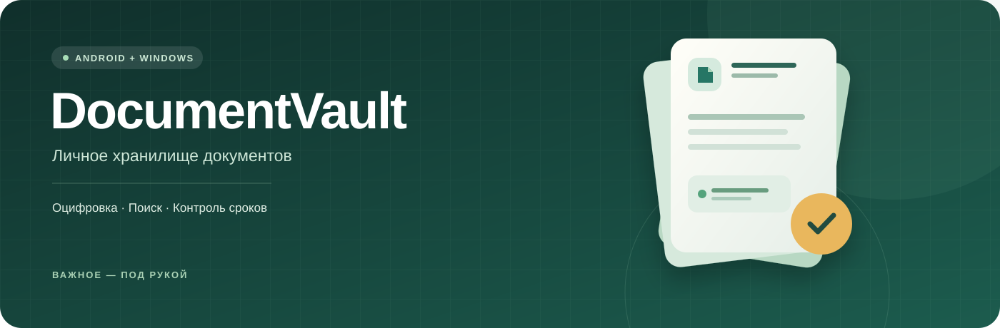
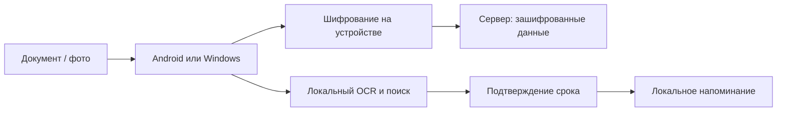

  

  <strong>Оцифровывайте документы, находите нужное и следите за сроками.</strong> 
  Android · Windows · локальное распознавание · клиентское шифрование

  <a href="#возможности">Возможности</a> ·
  <a href="#как-это-работает">Архитектура</a> ·
  <a href="#сборка-и-проверка">Сборка</a> ·
  <a href="#android">Android</a> ·
  <a href="#состав-проекта">Документация</a>

> **Статус: дипломный прототип.** Проект ещё не завершён и не прошёл независимую проверку безопасности. Используйте тестовые документы.

## Возможности

| | Что умеет приложение |
| --- | --- |
| **Оцифровка** | Импорт изображений и PDF; съёмка на Android. OCR выполняется на устройстве. |
| **Хранение** | Документы и закрытые метаданные шифруются на клиенте до отправки на сервер. |
| **Поиск** | Поиск по названию и распознанному тексту с поддержкой некоторых OCR-ошибок. |
| **Сроки** | Выделение дат с подтверждением пользователем и локальные напоминания. |
| **Доступ** | Android и Windows; на Android доступна локальная биометрическая разблокировка. |
| **Организация** | Папки и просмотр изображений и PDF в Android-приложении. |

## Как это работает

Случайный мастер-ключ создаётся на клиенте. На новом устройстве он восстанавливается отдельным паролем; биометрия Android защищает локальный доступ к ключу, но не создаёт одинаковый ключ из лица или отпечатка. Сервер видит служебные данные, включая логин, идентификаторы и размеры объектов.

## Сборка и проверка

Требуется JDK 21. Выполните `./gradlew test` (в Windows: `gradlew.bat test`).

## Локальный сервер

Выполните `gradlew.bat :server:run` в Windows или `./gradlew :server:run` в Unix. Сервер слушает только `127.0.0.1:7070`. Файл базы `documentvault.db` создаётся в рабочей директории серверного процесса. Путь к базе и порт можно задать переменными `VAULT_DATABASE` и `VAULT_PORT`. Проверка доступности: `GET http://127.0.0.1:7070/health`.

Протокол описан в [docs/server-api.md](docs/server-api.md). Сервер — прототип: есть квоты на аккаунт, резервное копирование SQLite и простые ограничители входа и регистрации в памяти. Полноценной защиты от перебора и независимого аудита пока нет. Не выставляйте его в сеть и не загружайте реальные персональные документы. Черновик сетевого развёртывания описан в [docs/deployment.md](docs/deployment.md).

## Клиент Windows

При работающем сервере запустите во втором терминале из папки проекта `gradlew.bat :desktopApp:run`. Создайте аккаунт, задайте отдельный пароль восстановления, войдите и разблокируйте хранилище. Затем можно загрузить файл до 15 МиБ, обновить список и сохранить выбранный документ. После разблокировки и обновления списка отображаются названия файлов, если они сохранены в зашифрованных метаданных; иначе отображаются идентификаторы.

Пароль восстановления нужен при каждой разблокировке: сохранение ключа в защищённом хранилище и Windows Hello ещё не реализованы. Сохранённая пользователем копия файла остаётся открытой на диске. По умолчанию приложение подключается к локальному серверу; адрес удалённого HTTPS-сервера можно задать переменной `VAULT_SERVER_URL`.

После загрузки файла OCR запускается автоматически; для повторной обработки выберите документ и нажмите «Распознать выбранный». Поддерживаются изображения и PDF до 20 страниц; модели русского и английского языков находятся в `tessdata`. Предложенные даты нужно проверить: на экране сохранения подтвердите дату окончания в формате `ГГГГ-ММ-ДД` или оставьте поле пустым. Распознанный текст и подтверждённая дата шифруются перед сохранением на сервере. После повторного входа разблокируйте хранилище и нажмите «Обновить», чтобы загрузить их для поиска.

Кнопка «Сроки» показывает подтверждённые даты, а «Изменить срок» позволяет указать или удалить дату без повторного OCR. При обновлении списка и сохранении срока приложение сохраняет локальное расписание, защищённое Windows DPAPI для текущей учётной записи. Кнопка «Включить фоновые уведомления» создаёт задание `DocumentVault-Reminders`: оно проверяет сроки при входе пользователя и ежедневно в 09:00, даже когда окно приложения закрыто. Уведомление не содержит названия документа и появляется не чаще раза в день. Windows может задержать или скрыть его; при выключенном компьютере уведомление не доставляется.

Для фонового задания требуется установленная сборка `gradlew.bat :desktopApp:installDist`. Задание ссылается на JDK и папку `desktopApp/build/install/desktopApp/lib`; удаление или перемещение этих файлов нарушит запуск. Даты с других устройств попадают в локальное расписание после входа, разблокировки и обновления списка. После выхода локальное расписание остаётся. Чтобы отключить фоновую проверку, удалите задание `DocumentVault-Reminders` в Планировщике заданий Windows.

OCR зависит от моделей [tessdata_fast](https://github.com/tesseract-ocr/tessdata_fast); путь к ним можно указать переменной `VAULT_TESSDATA`. Распознанный текст и поисковый индекс пока находятся в памяти только после разблокировки, а также зашифрованными на сервере. Автоматическая точность извлечения даты не гарантируется.

## Android

Для Android нужен SDK Platform 36 и Build Tools 36.0.0. Укажите путь SDK в `androidApp/local.properties` или переменной `ANDROID_HOME`. Из корня проекта выполните `gradlew.bat -p androidApp assembleDebug`. APK находится в `androidApp/build/outputs/apk/debug/DocumentVaultAndroid-debug.apk`. Android-модуль пока собирается отдельно от остальных модулей.

Текущий APK поддерживает регистрацию и вход через HTTPS, разблокировку паролем восстановления, список документов с расшифрованными названиями, выбор файла, съёмку через системное приложение камеры, шифрованную загрузку и сохранение документа. По умолчанию указан адрес сервера проекта; его можно заменить на свой HTTPS-адрес. Последний адрес, с которым удалось войти или зарегистрироваться, сохраняется на устройстве. После загрузки изображения или PDF до 20 страниц приложение предлагает локально распознанный текст и найденные даты; пользователь выбирает или вручную указывает срок и подтверждает его. Поддерживаются числовые даты в форматах день–месяц–год и год–месяц–день, а также даты с русским названием месяца. Текст и срок шифруются до отправки. Русская и английская модели включены в APK.

Документы можно группировать по папкам: откройте меню документа, выберите «Переместить в папку» и укажите существующую или новую папку. Папка появляется после перемещения в неё документа; пустые и вложенные папки пока не поддерживаются. Название папки находится в зашифрованных метаданных документа и синхронизируется через сервер. Поиск по названию и тексту охватывает все папки. Просмотр изображений и PDF доступен внутри приложения; PDF временно сохраняется в закрытой папке приложения и удаляется при закрытии просмотра или следующем запуске после аварийного завершения.

В меню документа доступны переименование и повторное распознавание. Изображения перед OCR переводятся в оттенки серого, небольшие изображения увеличиваются. При работе отображается индикатор, а для PDF — номер страницы. Распознанный текст можно исправить перед сохранением. Эти изменения не гарантируют точность OCR: фотографии с наклоном, бликами и мелким текстом требуют дополнительной проверки.

Для изображений приложение пытается найти контур документа, обрезать фон и выровнять перспективу перед OCR. Оригинал остаётся без изменений; если контур не найден или выбран неверно, можно повторить распознавание без обрезки. В меню изображения доступен «Просмотр с текстом OCR»: области распознанных слов закрываются серой подложкой, а текст отображается поверх с размером по области исходного слова. Координаты и слова сохраняются в зашифрованных метаданных. Старые изображения нужно распознать заново; для PDF наложение пока не поддерживается. Если при редактировании изменилось количество слов, наложение необходимо создать повторно. Подложка при просмотре не удаляет исходный текст из документа.

Поиск выполняется на телефоне по расшифрованным названиям и сохранённому тексту OCR; для работы требуется сначала разблокировать хранилище и обновить список. Поддерживаются некоторые похожие символы и одна ошибка в длинном слове. После блокировки поисковые данные удаляются из активного состояния приложения; строки JVM могут оставаться в памяти до сборки мусора.

После входа и разблокировки паролем восстановления можно включить биометрию для этого устройства. Мастер-ключ защищается ключом Android Keystore и открывается после системного биометрического подтверждения. Поддерживается только биометрия класса `BIOMETRIC_STRONG`; конкретный способ — лицо или отпечаток — выбирает система и зависит от устройства. При изменении биометрических данных или недоступности ключа потребуется пароль восстановления.

Подтверждённые сроки копируются в локальное расписание, зашифрованное отдельным ключом устройства. WorkManager периодически проверяет его и может показать общее уведомление за 30 дней до срока или после его истечения, без названия документа. На Android 13 и новее необходимо разрешить уведомления. Проверка выполняется приблизительно раз в сутки, с возможной задержкой из-за ограничений системы; после принудительной остановки приложения она может не выполняться до следующего запуска. Даты с другого устройства попадают в расписание после входа, разблокировки и обновления списка. При выходе локальные напоминания сохраняются; они удаляются при удалении данных приложения.

Срок отображается на карточке документа. Его можно добавить, изменить или удалить через меню карточки без повторного распознавания; перед сохранением укажите дату в формате `ГГГГ-ММ-ДД`.

На OPPO Reno 5 (Android 13) проверены запуск, регистрация, вход и восстановление ключа, настройка и разблокировка отпечатком с участием пользователя, распознавание синтетического русского и английского текста, PDF и повёрнутого JPEG, зашифрованное хранение расписания, доставка тестового уведомления, совместимость шифрования с Windows и обмен зашифрованным тестовым содержимым с локальным сервером через USB. Проверены съёмка тестового изображения, его зашифрованная загрузка и удаление временного файла, а также HTTPS-соединение с сервером. Перед OCR Android и Windows учитывают ориентацию EXIF, в том числе зеркальные варианты. Доставка уведомлений после перезагрузки и полноценная эксплуатационная проверка сервера ещё не проведены. Качество распознавания зависит от изображения.

Для OCR крупные изображения уменьшаются до размера не более 3000 пикселей по длинной стороне; на Windows при рендеринге страниц PDF действует тот же предел. Это снижает расход памяти, но мелкий текст может распознаваться хуже. Ограничение не гарантирует защиту от всех сложных или повреждённых файлов.

Отладочная сборка дополнительно разрешает HTTP только к `127.0.0.1` для локальных испытаний через `adb reverse`; опубликованная конфигурация требует HTTPS. Это тестовая возможность, не предназначенная для работы с реальными документами.

Снимок и временная копия PDF для распознавания сохраняются в незашифрованном виде в приватном кэше приложения, после обработки удаляются; при аварийном завершении остаток удаляется при следующем запуске. Само приложение камеры может иметь собственную политику сохранения снимков. Удаление файла не гарантирует физического стирания с накопителя.

## Состав проекта

| Каталог | Назначение |
| --- | --- |
| [`androidApp`](androidApp) | Мобильное приложение Android. |
| [`desktopApp`](desktopApp) | Клиент Windows и фоновые напоминания. |
| [`core`](core) | Криптография, поиск и извлечение дат. |
| [`server`](server) | API и хранение зашифрованных данных в SQLite. |
| [`experiments`](experiments) | Инструменты оценки OCR и поиска. |

Документация: [план и ограничения](docs/plan.md) · [протокол API](docs/server-api.md) · [развёртывание](docs/deployment.md) · [эксперименты](experiments/README.md) · [черновик пояснительной записки](docs/пояснительная-записка-черновик.md).
